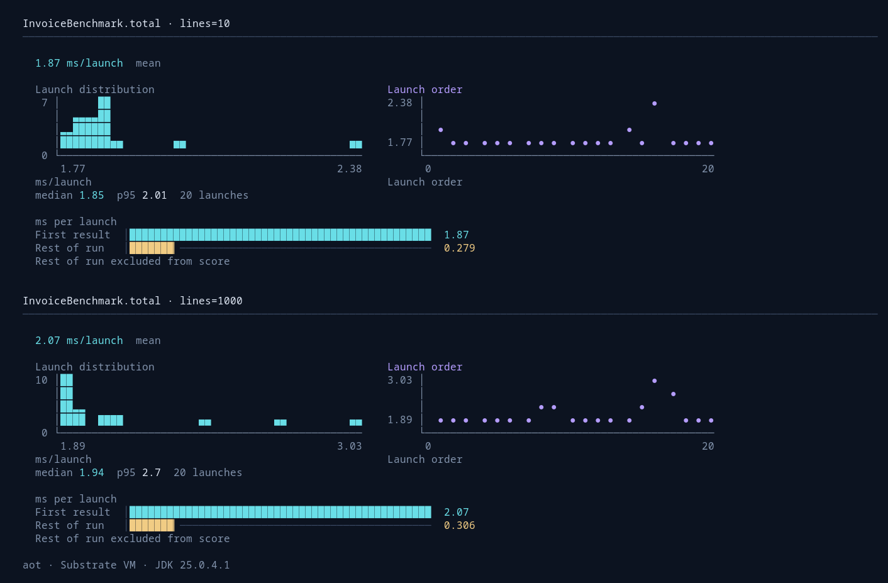
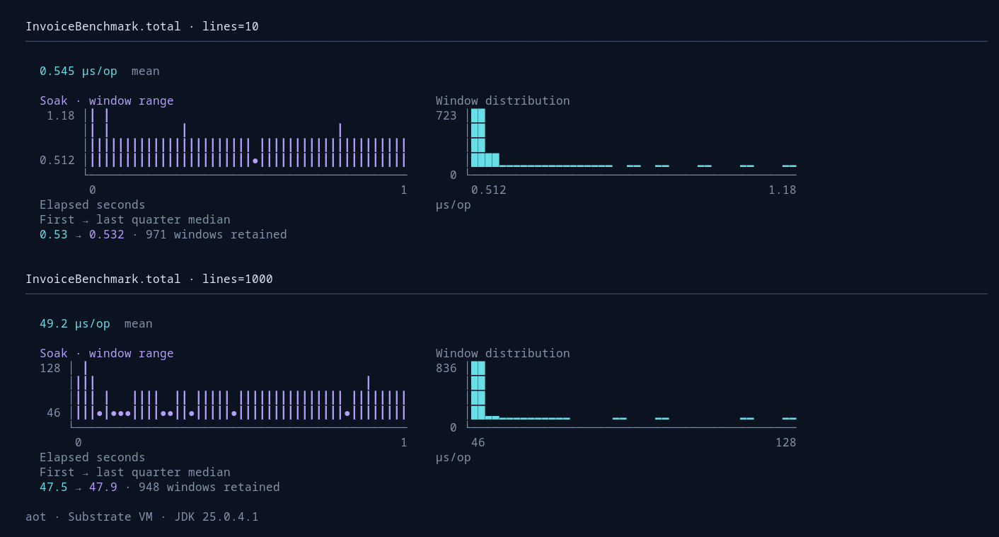

<!-- SPDX-FileCopyrightText: 2026 SMH contributors -->
<!-- SPDX-License-Identifier: Apache-2.0 OR MIT -->

# Startup, steady state, and soak

Choose the experiment with `--mode`; choose its measurement with `--backend`.
Experiment selection stays separate from profiler integration and existing PGO
profile options. It is also independent of average-time or throughput scoring
(`modes` in run JSON).

```sh
smh bench --build-config examples/build.json --config examples/run.json --mode startup --launches 30
smh bench --build-config examples/build.json --config examples/run.json --mode startup --until ready --launches 10
smh bench --build-config examples/build.json --config examples/run.json --mode soak --duration 5m
smh bench --build-config examples/build.json --config examples/run.json --mode soak --backend callgrind --operations 10000000
```

Use `--output NEW_DIRECTORY` to retain the experiment's requested and effective
configuration, logs, and reports in a named directory. Otherwise SMH chooses a
new directory under `build/smh-experiments`. Existing directories are rejected.
Exact observations remain in JSON; terminal values are rounded for readability.

| Mode | Wall measurement | Callgrind measurement | Main visual |
| --- | --- | --- | --- |
| `steady` (default) | Existing warmup and iteration policy | Fixed invocation windows | Histogram, with ordered observations alongside it |
| `startup` | Fresh-process launch to selected endpoint | Guest process entry to selected endpoint, all threads | Launch histogram and launch-order trace; endpoint and subsequent work on a shared scale |
| `soak` | One trial state for the full duration | One trial state for an exact operation budget | Timeline and window histogram, with early/late medians |

Native Image supports all combinations on supported platforms; Callgrind requires
Linux. SMH's HotSpot and Crema/Ristretto hosts support wall measurement. Delegated
JMH remains steady-only, including its Leyden cache workflow. These restrictions
fail explicitly. Results do not establish that any engine is faster in general;
compare the same workload and endpoint, and retain engine, build, and cache identity.

## Startup boundaries

Each case and parameter combination receives `--launches` fresh processes
(default 10). Compilation and an untimed discovery process precede measurement.
The default `--until first-result` includes host startup, configuration and
benchmark initialization, fixture setup, and one invocation. The other endpoints:

- `ready`: trial setup has completed. An application can call
  `dev.elide.smh.runtime.Startup.ready()` during initialization to declare readiness
  earlier. The first notification wins; the call is harmless outside a readiness
  experiment. This mode does not invoke the benchmark method.
- `exit`: one invocation, all fixture cleanup, report serialization, and process
  shutdown have completed.

For wall measurements, the parent starts its timer before launching the child and
stops when it receives the endpoint notification, or observes process exit.
The parent records each launch's process ID alongside its observations.
Notification transport and parent scheduling are included. Child completion is
retained separately. The displayed “Rest of run” value is the nonnegative difference
between these parent observations, not an independently timed cleanup phase.
A child must still exit successfully after readiness or first result; a later
cleanup failure invalidates that launch. `--timeout 30s` is the default per-process
safety limit, including cleanup. Failed launch logs and failure metadata are kept.

For simulation, collection starts at guest process entry. A preserved,
non-inlined `Startup.reached()` function triggers a snapshot before notification.
Subsequent events are retained separately. `exit` uses the termination dump.
All guest threads are aggregated. Parent work, OS kernel time, and elapsed time
are outside this event metric. This deliberately differs from wall launch timing.
The [Callgrind manual](https://valgrind.org/docs/manual/cl-manual.html) specifies
that dumps reset counters and that function-triggered dumps with separate thread
collection cover only the triggering thread. Startup therefore uses its own
process-wide import policy; ordinary benchmark-region validation remains strict.
The [format specification](https://valgrind.org/docs/manual/cl-format.html)
allows a process summary to exceed the sum of attributed call-graph costs.
Startup scores use the full summary and retain both summary and attribution
totals for each snapshot. Attribution totals exceeding the summary are rejected;
ordinary benchmark-region dumps still require exact agreement.

A fresh process is **not a cold filesystem cache**. Discovery and preceding
launches may warm caches. Reports label that cache state as uncontrolled.
Do not interpret startup histograms as independent host-condition samples or
claim accuracy qualification from their spread.

## Soak budgets and timelines

Wall soak requires `--duration`, with units `ns`, `us`, `ms`, `s`, `m`, or `h`.
Warmup runs first; measurement then continues for the whole budget, regardless of
statistical stability. `measurementNanos` controls the normal window size; the
last window is shortened to the remaining budget. A running invocation cannot
be interrupted safely, so the duration can overshoot. Single-shot scoring is
rejected. Trial state persists across windows; existing iteration/invocation
fixture semantics still apply.

The budget and horizontal axis use elapsed phase time, including fixtures and
between-window harness work. Each window's score retains the ordinary timed
invocation/batch boundary. The two scopes are recorded separately. A min–max
trace retains the range of every window falling in a screen column; it does not
silently downsample away spikes. The duration applies to each benchmark/parameter/scoring-mode trial, not the
entire command. Multiple trials are separate experiments.
When a result output is configured (automatic with `smh bench --mode soak`),
each completed window is appended to `results.json.progress.jsonl` outside timed
work. A later failure retains this journal and its failure reason; it is not a
successful result report. Simulation journals retain window work budgets while
raw Callgrind files retain counters. Interrupted journals may lack a final failure
record and must not be treated as complete runs.

Simulation soak requires `--operations`, counted in logical operations after
`OperationsPerInvocation`. The budget must be divisible by that value.
`invocationsPerIteration` sets window size; the final window may contain less
work. The report keeps each window's actual operation count and normalizes event
counts accordingly. The chart labels a partial final window: fixed per-window
loop/call overhead can affect its normalized score, so a last-window rise alone
is not proof of degradation. The horizontal axis is cumulative completed operations,
never simulated wall time. Warmup is outside the operation budget.

## Configuration and visual conventions

Run JSON uses singular `mode` (`steady`, `startup`, or `soak`), `until`, `launches`,
`timeoutNanos`, `durationNanos`, and `operations`. Explicit contradictory JSON is
rejected. CLI `--mode startup` replaces inherited iteration, batching, warmup,
and scoring policies; `--mode soak` replaces inherited measurement iteration and
stability limits. CLI `--backend callgrind` removes inherited wall-only policies
and supplies a 10,000-invocation window when needed. Both the requested and
effective configurations are retained so these overrides remain inspectable.

Histograms are retained in every mode. Plots use four rows; experiment panels
share a row at 90 columns and above and stack in narrower terminals. Their total
width is capped at 112 columns to keep multiple cases compact. Cyan identifies the primary observations and endpoint;
violet identifies run history and late windows; gold marks work after the
startup endpoint or qualification conditions. Color does not declare a winner.
Labels, axes, and shapes carry the same meaning without color. The startup bars
name the selected boundary (“Ready”, “First result”, or “Full run”) and show
“Rest of run” on the same scale. Startup displays
median and p95 with launch count; soak displays early and late medians with the
number of retained windows. These are descriptive summaries, not significance
or JIT-quiescence tests. Comparisons require matching experiment mode, startup
endpoint, units, and simulation model where applicable.

Copyable JSON policies are provided for [startup](../examples/startup-run.json),
[wall soak](../examples/soak-run.json), and
[simulation soak](../examples/soak-simulation-run.json). Pass one with
`smh bench --build-config examples/build.json --config PATH`.

Build diagnostics and cache decisions are saved in the printed build-log location;
`--verbose` replays them before results. Compiler subprocesses retain their own
full logs, referenced by that build log. Startup launch progress occupies a temporary
terminal line, cleared before the complete report is printed. Redirected output
contains no progress updates. Messages use a two-space margin and plot contents
use a four-space inset.

The raw `accuracy: unqualified` field means that general measurement accuracy has
not been established; it does not indicate a failed run. It is retained in JSON
rather than repeated in the default report. Actual failure and stopping reasons
remain visible.

## Terminal examples

These captures use short validation runs to show the layouts, not to compare
engine performance. The startup view retains the launch histogram and separates
post-endpoint work on a shared scale:



The soak view puts elapsed time first, keeps the window distribution alongside
it, and summarizes early versus late observations without hiding any windows:


